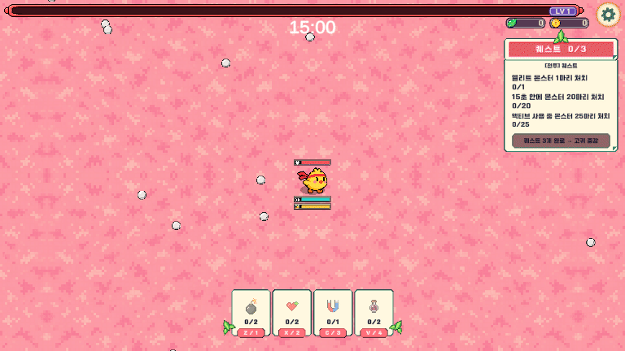
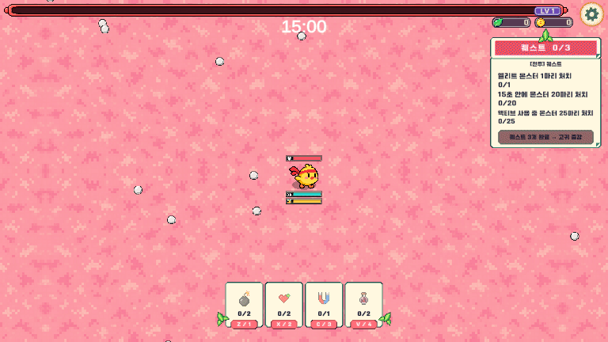

# Acquisition visual verification — 2026-11-15

- Unity 2022.3.62f3, actual Level1 scene and production item/relic runtime.
- ItemProcProof.Run: PASS; 587 recorded checks including 100 capture completions.
- 66 items + 34 relics; each capture has 96 frames at 30 fps, 768×432.
- Capture fixtures force the documented proc conditions; these are not natural-run balance measurements.
- All 34 new relic PNGs have alpha spanning 0–255. Their opaque body bounds do not touch the image edges.
- Each item resolves its own catalog image; all relics resolve the new transparent image.
- Relic acquisition geometry has no backing disc; pooled proc reuse clears the acquisition sprite.
- Existing ability, catalog cost and offer-policy files are unchanged.
- Game preferences altered by the capture were restored after Unity exited.

Reproduce with Unity -batchmode -projectPath <repository> -executeMethod Vampire.Tests.Editor.ItemProcProof.Run -logFile <log>. The harness exits itself. PNG frames are written under Library/ItemProcProof/frames. The GIF gallery is a delivery artifact, not a runtime asset.

Representative uncomposited game captures:

