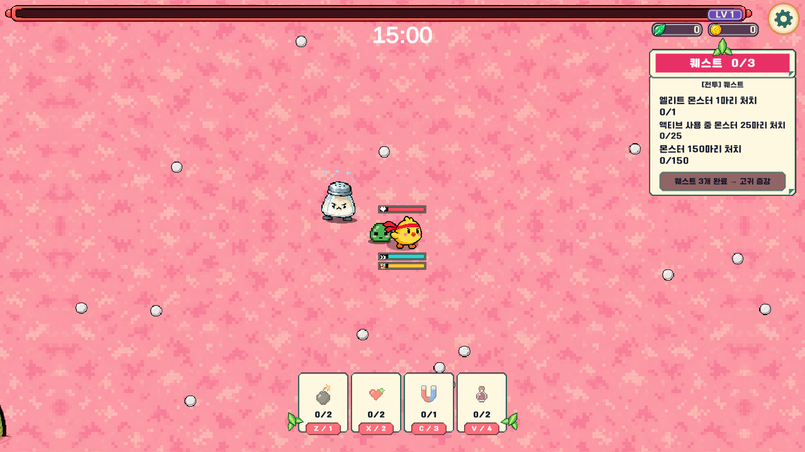
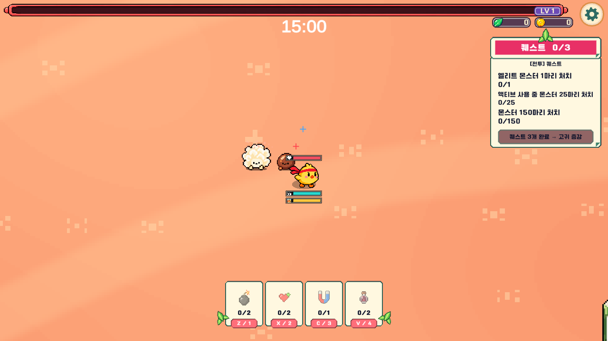
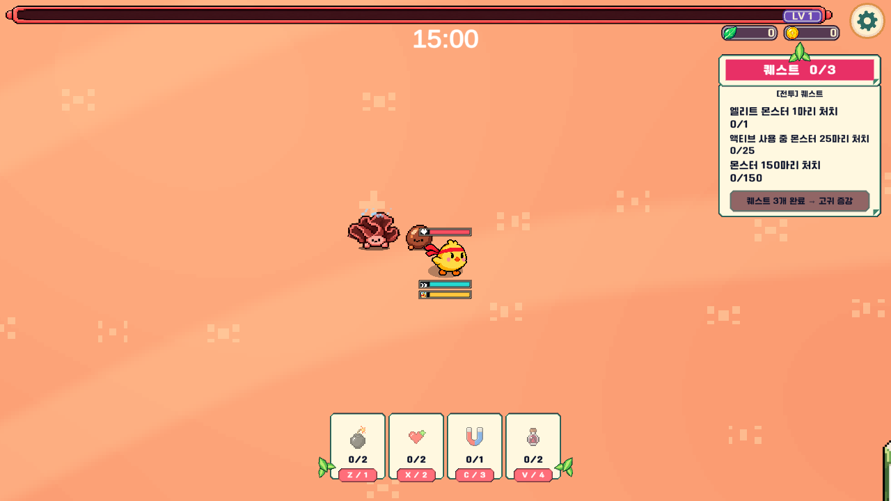
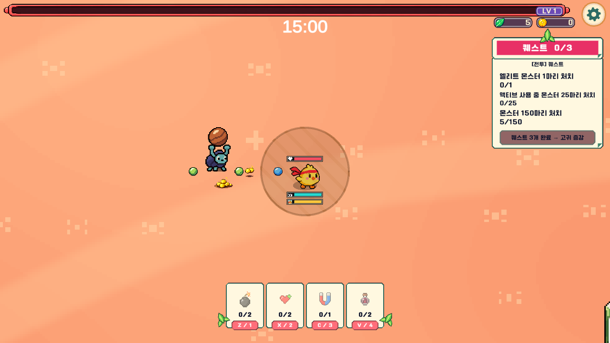
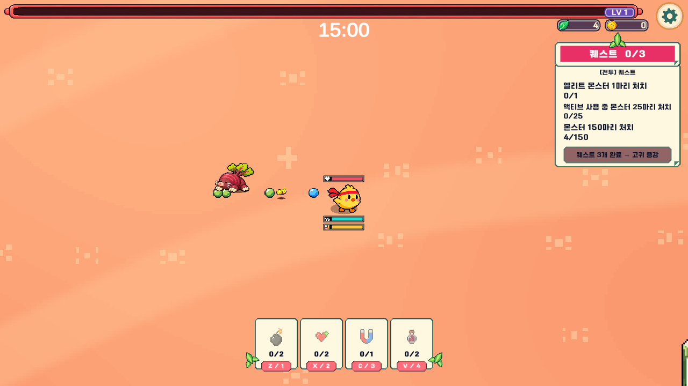
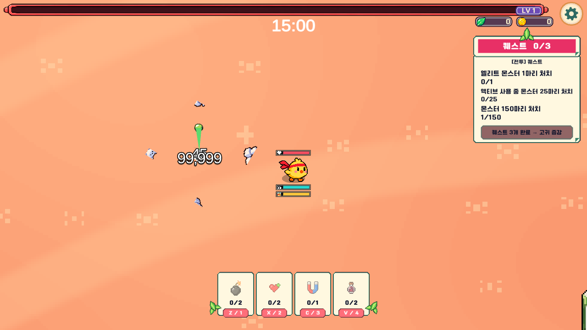
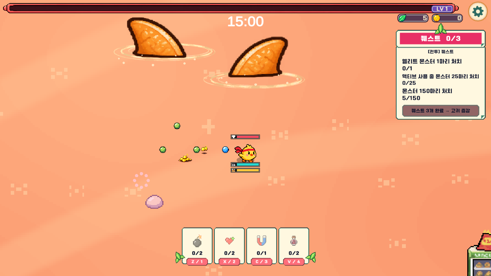
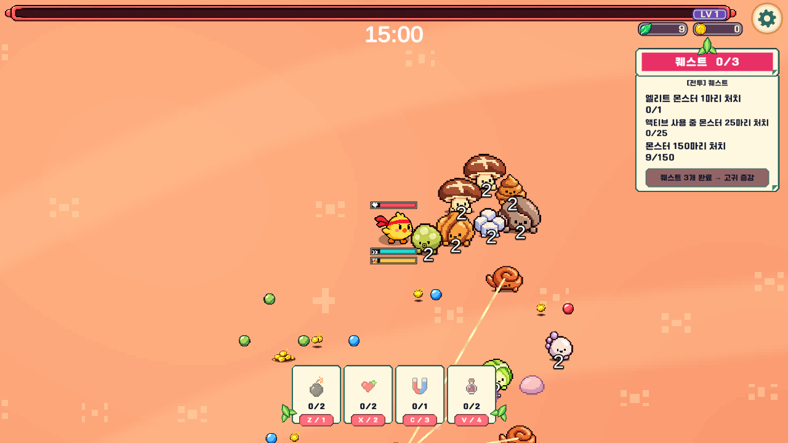

# 특수몹 개편 검수 — 2026-11-10

## 실행 결과

- `ColonSpecialSmoke.Run`: **64개 통과 / 오류 0**. 실제 메뉴→위장→대장 씬에서 신규 특수 5종, 버퍼, 두더지, 지느러미, 부활, 벽, 일시정지, 풀 재사용과 혼합 전투를 실행했다.
- `StageDirectEntrySmoke.Run`: **1,210개 통과 / 오류 0**. 최종 직접 입장 85% 특수몹 예산과 일반100→105% 밀도, 메뉴 선택·오프닝·기본 장비, 86개 오브젝트와 거주지6개, 일반8종 시간표·체력, 미니보스6종 등장·돌진·점수·보상을 검사했다. 직접 입장 종료 후 정상 위장→대장 연속 모드로 돌아가는 것도 확인했다.
- 첫 검사는 개별 기능과 혼합 전투 중심이며 마지막 직접 입장 예산 조정은 두 번째 검사에서 재확인했다. `special-*.txt`, `direct-*.txt`, `direct-balance.csv`, `direct-time-balance.csv`가 실행 산출물이다.
- 검수 환경: Unity 2022.3.62f3 Windows 에디터, 실제 게임 씬 Play Mode, 1280×720 렌더링. 자동 입력·무적·시계 이동·강제 능력 호출을 일부 사용했다. 사람의 클리어율 측정이나 모바일 실기기 장시간 테스트가 아니다.

## 확인한 동작

| 분류 | 확인 내용 |
|---|---|
| 버프 | 체력25%, 재시전 중첩/추가 회복 없음, 종료 원복. 실제 소금·후추 및 검은목이·흰목이 시전. 파란/빨간 + 동시 표시 |
| 균사 | 생존 대상 연결, 첫 쓰러짐 보상/처치 이벤트 없음, 30% 부활1회, 최종 처치1회, 시전자 사망 시 부활 취소 |
| 두더지 | 먹기2초, 성장 없음, 지하 직접 피해 차단·DoT 허용, 재등장, 점수·저장 보상 반환 |
| 소금결정 | 60/30% 균열, 중간 피격 발사 없음, 사망4파츠, 특수 처치1회 |
| 쇠똥구리 | 준비 중 피격 취소·낙하, 정상3초 준비·발사, 반환 시 들고 있던 똥 정리 |
| 가스/기포 | 플레이어 위치 변화 없음, 적 벽 관통 없음, 요구르트 접촉 돌진 대신 공전 |
| 스폰 | 신규 종류/점수/표시 크기, 86개 초기 오브젝트 벽 제외, 실제 시간표의 버퍼 쌍 생성, 직접/연속 배율 |
| 상태·정리 | 런 일시정지 중 준비/모션 정지, 풀 재사용 잔여 제어/소품 없음, 혼합 전투 60초 후 벽 안 개체 없음 |
| 지느러미 | 대기와 기술 소품의 바닥 물결3겹, 거품, 실제 하단 위치와 크기 연결 |

## 스폰량 산정

고정 시드10,000회, 15분 동안 스케줄상 생성 요청 수의 기대값을 비교했다. 기존 스케줄의 첫 등장~900초 진행률에 따라 추가 개수가 늘고, 직접/연속·옥수수·버퍼 쌍 보정을 적용한다.

| 구성 | 15분 생성 요청 기대값 |
|---|---:|
| 스테이지 1 기준 | 103.75 |
| 스테이지 2 직접 입장 | 101.24 |
| 스테이지 2 연속 입장 | 141.75 |

이 값은 함정 필드, 분열 자식, 미니보스 소환 부하 및 생존 개체 상한을 제외한 **스케줄 비교**다. 실제 동시 생존 수나 처치 수는 아니다. 직접 입장은 총량이 비슷하면서 종류가 다양하고, 연속 입장은 특수 능력이 더 자주 섞이도록 정했다. 신규 생존 상한4/7 때문에 실제 생성 수는 위 기대값보다 적을 수 있다. 세부값은 `spawn-estimate.json`에 보존했다.

## 실제 화면

소금 헤드뱅잉/가루:

두 효과를 받은 대상의 파란/빨간 표시:

버섯 겹 펼치기:

투척 준비와 두더지 먹기:

소금 몸체 파편과 상어 바닥 접촉:

혼합 전투 종료 시점:

최종보스 변비왕, 웹·설치본 재배포와 원격 랭킹 서버 게시, 모바일 실기기 부하 검증은 이번 완료 항목에 포함하지 않는다.
