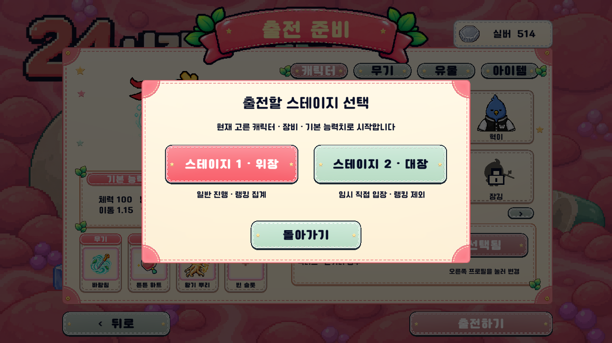
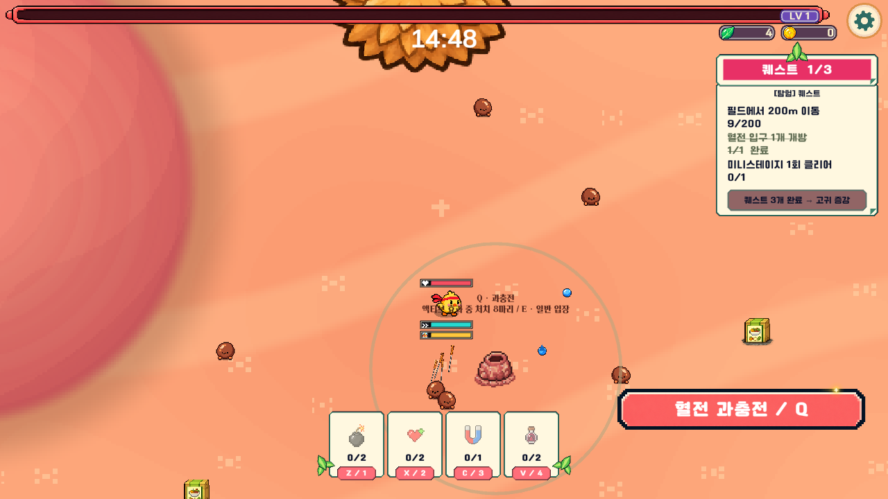
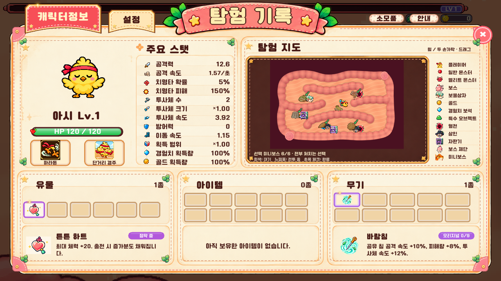

# 스테이지 2 벽·점수·직접 입장 패치 — 2026-11-09

## 플레이에서 달라진 점

- 출전준비의 **출전하기 → 스테이지 1 / 스테이지 2** 임시 선택창. 취소 시 장비 유지, 중복 출전 방지. 스테이지 2 직접 입장도 준비한 캐릭터·장비·기본 능력치로 출발한다.
- 대장 로딩 완료 전에 상자24·상인12·혈전14·엘리트제단8·골드병20·실버병8 및 미니보스 거주지6곳을 배치한다. 외곽벽과 내부벽의 보이는 발밑까지 스폰 금지 범위로 잡는다.
- 플레이어 침, 이동하는 적 투사체, 지상 파동·액체 공격은 벽을 통과하지 않는다. 바닥 경고도 벽 너머에 보이지 않게 처리한다. 공중 도약·투척은 벽을 넘을 수 있지만 착지 피해는 착지점과 같은 쪽으로 제한한다. 플레이어 벽 오르기·미끄러짐은 유지한다.
- 일반 진행의 스테이지 1 카멜레온4종과 스테이지 2 선택 미니보스6종은 모두 **미니보스 처치 500점**. 선택 미니보스는 최종보스 처치 수에 포함하지 않으며 스테이지를 끝내지 않는다.
- 발견한 거주지는 지도에 남는다. 흰색은 대기, 느낌표는 전투 중, 초록 체크는 완료. Tab 지도에 선택 토벌 진행도 N/6와 안내를 표시한다.
- **변비왕 제외.** 스테이지 2 필수 최종보스 자리와 역할은 별도 작업용으로 유지한다.

## 직접 입장 전용 밸런스

직접 입장에서는 미성장 캐릭터로 출발하기 때문에 성장한 캐릭터가 들어오는 기존 연속 플레이와 수치를 분리했다. 원본 스테이지 1 에셋은 수정하지 않고 실행 중 복사본에 적용한다. 직접 입장 기록은 공정한 비교가 어려워 임시 일반 랭킹 제출에서 제외한다.

| 스테이지 2 일반몹 | 대응 스테이지 1 HP | 직접 입장 HP | 접촉 피해 | 속도 |
|---|---:|---:|---:|---:|
| 동글 똥알 |25|27.5|5|0.70|
| 검은콩 반질이 |35|39.0|6|0.75|
| 한바퀴 똥말이 |65|73.4|8|0.75|
| 표고 갓둥이 |120|137.1|9|0.90|
| 호두 주름이 |125|144.6|10|0.90|
| 갈라진 똥돌 |170|199.1|12|0.90|
| 양배추 겹겹이 |220|260.9|13|0.88|
| 세층 똥탑 |260|312.0|14|0.82|

일반몹 등장 시간과 섞이는 비율도 스테이지 1을 따라간다. 같은 시각의 가중평균 HP는 +10~20% 안에 있고, 15분에는 약 +19.1%다. 기존 성장형 대장의 후반종 조기 등장 시간표는 직접 입장에 사용하지 않는다.

스폰 빈도는 원본의 같은 시각 대비 **1.15 → 1.30배**, 시작은 초당 0.7 → 0.805마리. 8분 이후 기존 공통 30% 증가 규칙은 양쪽에 한 번씩만 적용된다. 일반몹 개체 상한은 224 → 292. 특수몹 스케줄은 유지하며 HP는 대응 원본의 1.15배, 접촉/폭발 피해는 원본 기준이다.

일반·특수 경험치는 기본 능력치로 시작하는 원본 보상을 사용한다. 엘리트는 대응 일반몹의 직접 입장 HP와 원본 엘리트 체력 배율을 사용하며, 접촉 피해는 해당 일반몹의 1.2배, 속도는 1.04배다. 엘리트 종류 해금 시점도 직접 입장용 등장 시간표에 맞춘다.

| 선택 미니보스 | HP | 접촉 피해 | 패턴 기준 피해 |
|---|---:|---:|---:|
| 도넛플라밍고 |3,000|12|16|
| 바게트상어 |3,000|14|20|
| 푸딩바다사자 |3,000|12|18|
| 밤송이고슴도치 |3,000|12|18|
| 멜론바다거북 |3,000|14|18|
| 배매너티 |3,000|12|18|

카멜레온 원본 HP2,500 ×1.2. 각 패턴의 배율은 유지한다. 예를 들어 상어 도약은22, 플라밍고 연속탄은10.88, 푸딩 파동은13.5, 거북 씨앗은9.9~13.5다. 피격 방어·무적 등 기존 규칙은 유지된다. 직접 입장 미니보스 실제 보상은40골드·60경험치. 본체 크기·패턴·경고 시간·디자인은 바꾸지 않았다.

스테이지 1을 정상 클리어한 후 진입하면 기존 일반몹 HP70~600, 미니보스 HP26,000~36,000 및 성장형 보상을 유지한다.

## 검증 증거

- 지형/배치: **256개 시드, 거주지1,536개, 누락/벽 겹침/고립 구간 오류0**. 86개 필드 오브젝트 유지. 실제 최소 거주지 간격11.020. [지형 결과](map-validation.txt)
- Unity 실제 플레이 벽·전투 검증: **252개 검사 통과**, 오류 로그0. 188개 실제 몬스터 생성, 초고속 투사체 벽 관통 방지, 실제 렌더링 경고 마스크 읽기, 같은 쪽 공격 피해 유지, 카멜레온4종/미니보스6종 점수, 모든 소환 및25개 패턴을 포함한다. [검사 목록](wall-combat-checks.txt) · [패턴 실행 기록](patterns.csv)
- Unity 기존 캡슐 이동 회귀: **77개 검사 통과**, 오류 로그0. 승선·로딩·문 열림·1초 대기·성장 유지·벽 오르기/대쉬/미끄러짐을 확인했다. [검사 목록](capsule-checks.txt)
- 직접 입장 최종 회귀: **1,209개 검사 통과**, 오류 로그0. 선택창 실제 버튼, 취소/중복 방지, 1스테이지 한정 데모 차단, 같은 장비 전달, 입구 연출 동안 타이머 정지, 15분 시간대별 구성/HP/스폰 비율, 여섯 미니보스 소환·돌진·실제 보상, 직접 입장 종료 뒤 일반 진행의 수치 복귀를 확인한다. [검사 목록](direct-checks.txt) · [시간대별 수치](time-balance.csv) · [실제 수치](balance.csv)
- Cloud Code 로컬 검증: 점수 가중치, 입력 거부, 티켓·재시도·최고점 갱신 테스트 통과. 카멜레온4+대장 미니보스6의 합산 허용과 최종보스 카운터 오분류 거부를 추가했다. 서버 점수 규칙 변경이나 실서버 배포는 하지 않았다.

자동 플레이는 실제 Unity 게임 로직을 실행한 회귀/전투 검사다. 초기 장비 침으로 일반몹을 처치하는 확인은 무적·정지 상태의 통제된 검사이며, 사람의 승률이나 전체 15분 수동 플레이 성과로 해석하지 않는다. 실제 온라인 랭킹 제출 성공률도 이번 로컬 테스트의 검증 범위가 아니다.

## 실제 게임 화면

